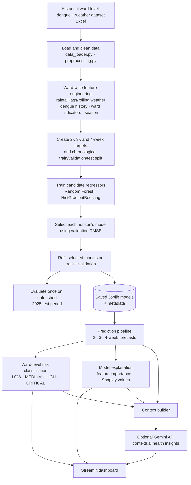

# MosquiTech — Architecture Design

## 1. System Data Flow

The application loads weekly ward-level records, cleans and orders them, and creates ward-specific lag and rolling features. Separate forecasting models produce 2-, 3-, and 4-week predictions. Predictions are classified into ward-level risk tiers and displayed with model explanations in the Streamlit dashboard. The optional Gemini assistant receives context derived from these existing outputs; it does not generate or replace the numerical forecasts.

## 2. Chronological Validation Split

The project uses a chronological split based on the **date of the target week being predicted**, not a random row split. For each forecast horizon, the target is the same ward's dengue case count 2, 3, or 4 weeks after the feature week.

| Split | Target-week period | Purpose |
|---|---|---|
| Training | Through 2022-12-31 | Fit candidate models and training-only risk thresholds |
| Validation | 2023-01-01 to 2024-12-31 | Compare candidates and select the model using RMSE |
| Test | 2025-01-01 onward | Final out-of-sample evaluation, performed once |

The split is applied separately to each horizon using its future `target_date`. The resulting row counts are:

| Horizon | Training | Validation | Test |
|---|---:|---:|---:|
| 2 weeks | 21,540 | 6,300 | 3,120 |
| 3 weeks | 21,480 | 6,300 | 3,120 |
| 4 weeks | 21,420 | 6,300 | 3,120 |

This approach reflects real forecasting: models are trained on earlier periods, selected on a later period, and assessed on a still later unseen period. It prevents future target weeks from entering the training set. Features are calculated within each ward after sorting by date; lag and rolling calculations use only current and previous weeks. Future dengue values are used only as the prediction targets. Risk thresholds are fitted using training-period cases only. After model selection, the selected configuration is refitted on training plus validation data, then evaluated once on the untouched 2025 test period.

## 3. Model Selection Rationale

For each horizon, the training pipeline compares five tree-based candidates: two Random Forest configurations and three HistGradientBoosting configurations. It also evaluates a simple baseline that predicts using the previous four-week mean.

The selected model is the candidate with the **lowest validation RMSE** for that horizon. RMSE is used as the selection criterion because it penalizes larger errors more heavily, which is important when forecasting dengue increases and outbreak peaks. MAE and R² are also reported to provide complementary views of error and fit. The held-out test period is not used to choose a model.

| Forecast horizon | Selected model | Validation RMSE |
|---|---|---:|
| 2 weeks | HistGradientBoosting (depth=4) | 2.116 |
| 3 weeks | HistGradientBoosting (leaves=15) | 2.060 |
| 4 weeks | RandomForest (leaf=15) | 2.663 |

The selected configurations are refitted on the combined training and validation periods before the final test evaluation. On the 2025 test period, all three selected models outperform the four-week-mean baseline on MAE and RMSE. This horizon-specific selection allows the project to use the model configuration that performed best for each forecasting distance rather than assuming one model is best for every horizon.

*Source of implementation details: `src/feature_engineering.py`, `src/train_model.py`, `src/config.py`, `models/metadata.json`, and `reports/evaluation_report.md` / `reports/model_comparison.csv` in the project repository.*
